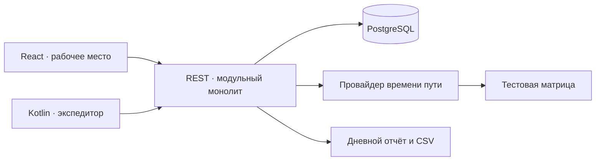

# ФАРВАТЕР · проект локального MVP

## Цикл работы

| Момент | Ответственный | Что видит и делает | Условие перехода |
| --- | --- | --- | --- |
| Звонок клиента | Оператор | Выбирает клиента или вводит контакты, адрес, день, произвольное окно и состав заказа. Проверяет сумму до сохранения | Вода и тара имеют отдельные цены. Безнал требует компанию |
| Планирование | Экспедитор | Подтверждает выход на дату в своей смене | У машины и водителя только одна смена в день |
| Распределение | Диспетчер | Видит очередь и подтверждённые смены. Запускает подбор или указывает конкретную смену | Проверяем окно, окончание работы с возвратом на базу, вес и полную высоту. Заказ с проблемой остаётся в очереди с причиной |
| Публикация | Сервер | Отдаёт водителю его рейсы и контакты | Завтрашние точки открываются в 18:00 по часовому поясу базы |
| Погрузка | Экспедитор | Сверяет загрузку и вводит фактическое время выезда | На борту достаточно воды для плана, суммарная масса в допуске. Один активный рейс |
| Доставка | Экспедитор | Проверяет адрес и сумму, звонит, вводит полученную тару и факт оплаты | Одна транзакция фиксирует заказ, движение воды, тару, деньги и начисление |
| Возвращение | Экспедитор | Отмечает возвращение на базу. При необходимости начинает второй рейс | Все точки рейса обработаны |
| Сверка | Экспедитор | Вводит пересчитанные полные бутыли, пустую тару, наличные, подтверждённый безнал и часы грузчика | Сервер сохраняет разницу по каждому показателю. Денежные поля в копейках |
| Отчёт | Диспетчер | Видит ожидаемое, сданное и расхождения по смене. Выгружает день | Исходные записи сохраняются при расхождении |

## Границы компонентов

В одном репозитории живут приложения, SQL-миграции, сквозные проверки и CI. API остаётся единственным владельцем бизнес-правил. Профиль локального PostgreSQL WASM позволяет запустить те же миграции без Docker. В Compose и в интеграционной проверке CI используется сервер PostgreSQL. Базовый адрес, часовой пояс, доступы, параметры времени и тестовая цена воды приходят из окружения.

Смена связывает дату, водителя и машину. Рейс принадлежит смене и содержит упорядоченные точки. Заказ хранит снимок условий доставки и цен. Фактические операции привязаны к рейсу и заказу. Отчёт собирается по смене. Версия заказа защищает от устаревшего изменения, ключ операции позволяет повторить отправку после обрыва связи. Подтверждение доставки и списания коммитятся вместе.

## План маршрута и учёт

Планировщик перебирает места вставки в каждый доступный рейс подтверждённых водителей и вариант второго рейса. Сначала идут заказы с ранним окончанием окна. Каждая вставка сохраняет относительный порядок прежних точек и пересчитывает оба рейса. Время начала обслуживания равно максимуму из ETA и начала окна. Окончание обслуживания должно попасть в окно, возврат на базу — до конца смены. Тайминг учитывает количество бутылей, этаж без лифта, КПП и грузчика. Из допустимых вариантов выбирается тот, который требует меньше дополнительного движения и погрузки, затем сравнивается изменение времени завершения смены и занятость. Тестовый провайдер моделирует время между точками. Непроверенный адрес и неизвестная полная высота при ограничении въезда требуют решения человека. Для ручного назначения действуют те же проверки. При невозможности переназначения прежний маршрут сохраняется. Начатые рейсы фиксируются, новые заказы можно направить в следующий рейс.

Загрузка воды учитывается в полных бутылях по 20 кг. Продажа новой тары означает продажу оболочки доставленной полной бутыли, отдельно от воды в чеке. Обратная тара учитывается по факту. В этой версии количество проданной тары ограничено количеством воды. Пустая тара как отдельный продаваемый товар потребует отдельной операции. Цена воды фиксируется оператором при создании. Новая тара стоит 250 ₽. Подтверждённая выручка группируется по способу оплаты, неоплаченная сумма показывается отдельно. За выполненную точку начисляется ставка по категории клиента и наличию грузчика плюс ставка за фактически выданные бутыли. До согласования группировки адресов одна остановка соответствует одному заказу.

## Экраны и эргономика

В одной доставке могут быть бутыли 19 л разных брендов. Оператор набирает корзину из карточек номенклатуры. Расчёт массы использует общий объём в бутылях по 20 кг, расчёт чека использует цены каждой строки. Название и цена сохраняются снимком, склад ведётся по постоянному идентификатору позиции. На загрузке и на сдаче водитель пересчитывает каждый бренд. Система выделяет пересортицу при совпадении общего числа бутылей.

**Оператор.** В шапке рабочая дата и кнопка «Новый заказ». Ниже сводка за день и журнал с адресом, окном, количеством, статусом и суммой. Форма следует порядку разговора: кто звонит → куда и когда → сколько воды и тары → как оплатит. Дополнительные поля раскрываются по выбору. Итог виден до отправки. При ошибке введённые значения остаются в форме.

**Диспетчер.** Один переключатель переводит из журнала в «Маршруты». Карточки смен показывают водителя, машину, доступное время и статус выхода. Ниже расположены рейсы с последовательностью остановок и временем прибытия. Для тестового провайдера достаточно линейной схемы «База → точки → база». В очереди видны конкретные причины, например ограничение по высоте. Ручное назначение доступно без перетаскивания.

**Экспедитор.** Одна вертикальная колонка. Сначала дата, график и машина, затем следующее допустимое действие. Перед выездом показываем запас воды и задаём время выезда. В рейсе на первом плане адрес, окно, объём и сумма. Звонок открывает системный набор номера. На сдаче отдельные подписанные поля для воды, тары, наличных и безнала. После сохранения показываем результат сверки. Экран входа и ошибки связи дают возможность вернуться к действию.

**Визуальный язык.** Тёмно-синий бренд, морской зелёный для навигационного мотива, синий для основного действия, холодный нейтральный фон. Иерархия строится на заголовке, значении и подписи. Количество, валюта и время имеют явные единицы. Статус всегда подписан. Шрифт поддерживает кириллицу и увеличение размера. Базовый шаг сетки 4 px, расстояние между группами 16–24 px. Поля имеют постоянные подписи. Видимый фокус, клавиша Escape в диалогах, перенос колонок на узком экране. Цель для Android — зона касания от 48 dp.

## Очерёдность и приёмка

1. **Основа.** Чистый checkout собирается из lock-файлов. Настройки локальные, адрес базы пуст до заполнения.
2. **Данные.** Миграции запускаются повторно. Демоданные создаются один раз. Характеристики машин, категории клиентов и тарифы проверяются тестами.
3. **Планирование.** Заказ после 18:00 попадает в позднюю смену. Сверхтяжёлый заказ остаётся в очереди. Ручной выбор подчиняется всем ограничениям.
4. **Исполнение.** Водитель получает только свои опубликованные назначения. Отправка одного подтверждения дважды создаёт одну запись в учёте.
5. **Сверка.** Точная сдача закрывается с совпадением. Разница зафиксирована по виду денег или остатков. Руководитель получает дневную выгрузку.
6. **Клиенты.** Проверяем браузером создание заказа и диспетчерскую панель, затем сборку APK. Занятые эмуляторы сохраняем для текущих работ владельца.
7. **Следующий этап.** Натурная проверка смены с экспедитором, проверка системных напоминаний и TalkBack на телефонах, корректировка времени обслуживания и полноценная очередь офлайн-событий. Для подключения реальных карт нужны проверенные адрес базы, высоты машин и поставщик маршрутизации.
