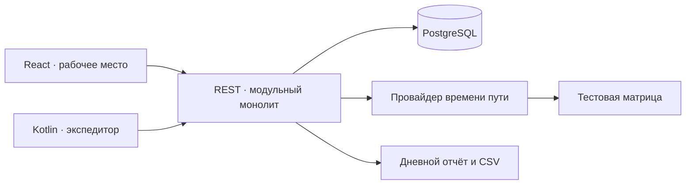

# WaySlate · проект локального MVP

## Цикл работы

| Момент | Ответственный | Что видит и делает | Условие перехода |
| --- | --- | --- | --- |
| Звонок клиента | Оператор | Выбирает клиента или вводит контакты, адрес, день, произвольное окно и состав заказа. Проверяет сумму до сохранения | Вода и тара имеют отдельные цены. Безнал требует компанию |
| Планирование | Экспедитор | Подтверждает выход на дату в своей смене | У машины и водителя только одна смена в день |
| Распределение | Диспетчер | Видит очередь и подтверждённые смены. Запускает подбор или указывает конкретную смену | Проверяем окно, окончание работы с возвратом на базу, вес и полную высоту. Заказ с проблемой остаётся в очереди с причиной |
| Публикация | Сервер | Отдаёт водителю его рейсы и контакты | Завтрашние точки открываются в 18:00 по часовому поясу базы |
| Погрузка | Экспедитор | Сверяет загрузку и вводит фактическое время выезда | На борту достаточно воды для плана, суммарная масса в допуске. Один активный рейс |
| Доставка | Экспедитор | Проверяет адрес и сумму, звонит, вводит полученную тару и факт оплаты | Одна транзакция фиксирует заказ, движение воды, тару, деньги и начисление |
| Возвращение | Экспедитор | Отмечает возвращение на базу. При необходимости начинает второй рейс | Все точки рейса обработаны |
| Сверка | Экспедитор | Вводит пересчитанные полные бутыли, пустую тару, наличные, подтверждённый безнал и часы грузчика | Сервер сохраняет разницу по каждому показателю. Денежные поля в копейках |
| Отчёт | Диспетчер | Видит ожидаемое, сданное и расхождения по смене. Выгружает день | Исходные записи сохраняются при расхождении |

## Границы компонентов

В одном репозитории живут приложения, SQL-миграции, сквозные проверки и CI. API остаётся единственным владельцем бизнес-правил. Профиль локального PostgreSQL WASM позволяет запустить те же миграции без Docker. В Compose и в интеграционной проверке CI используется сервер PostgreSQL. Базовый адрес, часовой пояс, доступы, параметры времени и тестовая цена воды приходят из окружения.

Смена связывает дату, водителя и машину. Рейс принадлежит смене и содержит упорядоченные точки. Заказ хранит снимок условий доставки и цен. Фактические операции привязаны к рейсу и заказу. Отчёт собирается по смене. Версия заказа защищает от устаревшего изменения, ключ операции позволяет повторить отправку после обрыва связи. Подтверждение доставки и списания коммитятся вместе.

## План маршрута и учёт

Планировщик перебирает места вставки в каждый доступный рейс подтверждённых водителей и вариант второго рейса. Сначала идут заказы с ранним окончанием окна. Каждая вставка сохраняет относительный порядок прежних точек и пересчитывает оба рейса. Время начала обслуживания равно максимуму из ETA и начала окна. Окончание обслуживания должно попасть в окно, возврат на базу — до конца смены. Тайминг учитывает количество бутылей, этаж без лифта, КПП и грузчика. Из допустимых вариантов выбирается тот, который требует меньше дополнительного движения и погрузки, затем сравнивается изменение времени завершения смены и занятость. Тестовый провайдер моделирует время между точками. Непроверенный адрес и неизвестная полная высота при ограничении въезда требуют решения человека. Для ручного назначения действуют те же проверки. При невозможности переназначения прежний маршрут сохраняется. Начатые рейсы фиксируются, новые заказы можно направить в следующий рейс.

Загрузка воды учитывается в полных бутылях по 20 кг. Продажа новой тары означает продажу оболочки доставленной полной бутыли, отдельно от воды в чеке. Обратная тара учитывается по факту. В этой версии количество проданной тары ограничено количеством воды. Пустая тара как отдельный продаваемый товар потребует отдельной операции. Цена воды фиксируется оператором при создании. Новая тара стоит 250 ₽. Подтверждённая выручка группируется по способу оплаты, неоплаченная сумма показывается отдельно. За выполненную точку начисляется ставка по категории клиента и наличию грузчика плюс ставка за фактически выданные бутыли. До согласования группировки адресов одна остановка соответствует одному заказу.

## Экраны и эргономика

Количество воды, тара, масса и суммы выделены фиолетовым. Число и единица измерения читаются вместе. Даты, номера заказов и названия брендов сохраняют основной цвет. Для расхождений в сверке предусмотрены отдельный столбец и явный статус. Акцент `#68418B` на белом фоне даёт контраст 7,73:1, `#D7B8F5` на тёмном фоне `#192936` — 8,55:1.

В одной доставке могут быть бутыли 19 л разных брендов. Оператор набирает корзину из карточек номенклатуры. Расчёт массы использует общий объём в бутылях по 20 кг, расчёт чека использует цены каждой строки. Название и цена сохраняются снимком, склад ведётся по постоянному идентификатору позиции. На загрузке и на сдаче водитель пересчитывает каждый бренд. Система выделяет пересортицу при совпадении общего числа бутылей.

**Рабочее место оператора.** Боковая навигация сохраняет доступ к заказам, маршрутам, карте и справочнику. Выбор рабочего дня относится к журналу, маршрутам и отчёту. В разговоре оператор сначала находит клиента, затем уточняет адрес и время, собирает корзину и подтверждает оплату. Дополнительный телефон, условия доступа и координаты вводятся по необходимости. В истории можно найти доставку по старому адресу или телефону получателя, а затем повторить её на выбранную дату.

**Планирование и разбор проблем.** В «Маршрутах» диспетчер выбирает смену и видит машину, рейсы, окна клиента, расчётное прибытие и очередь с причинами отказа. Ручное назначение проверяет ограничения. При редактировании назначенной точки оператор видит сообщение о возврате в очередь. Регистрация недоставки сохраняет причину, а повторная попытка получает отдельный номер.

**Карта рейсов.** Визуальный референс директора помог выбрать нумерованные остановки, отдельные цвета рейсов и переход к деталям из списка. В веб-панели выбранный рейс можно выделить, изолировать или просмотреть вместе с остальными. В Android отображаются опубликованные рейсы вошедшего экспедитора. Схема показывает порядок при неполных данных. Географическая карта ставит маркеры по заданным координатам и сообщает о пропущенных. Форма и список остаются доступны для проверки адреса.

**Кабинет экспедитора.** Нижняя навигация разделяет «Смену», «Маршрут», «Остатки» и «Профиль». Главный экран показывает следующее допустимое действие. На точке сначала видны адрес, окно и состав выдачи, затем телефон и условия входа. Режим карты сохраняет фильтр рейса. Перед сдачей водитель отдельно сверяет воду каждого бренда, пустую тару, наличные и безнал.

**Визуальный язык.** Тёмно-синий бренд, морской зелёный для навигационного мотива, синий для основного действия, холодный нейтральный фон. Иерархия строится на заголовке, значении и подписи. Количество, валюта и время имеют явные единицы. Статус всегда подписан. Шрифт поддерживает кириллицу и увеличение размера. Базовый шаг сетки 4 px, расстояние между группами 16–24 px. Поля имеют постоянные подписи. Видимый фокус, клавиша Escape в диалогах, перенос колонок на узком экране. Цель для Android — зона касания от 48 dp.

## Откуда взяты решения по интерфейсу

- Связанный выбор остановки в списке и на карте помогает диспетчеру переходить от географии к заказу. Эту связку можно увидеть в руководстве Onfleet. [Onfleet · Map & Sidebar](https://support.onfleet.com/hc/en-us/articles/360023669612-Map-Sidebar)
- Для рейса важно читать остановки в порядке выполнения и видеть их время. В WaySlate рядом с остановкой показаны окно клиента и ETA. При разработке использовали описания расписания водителя и временной шкалы OptimoRoute. [Приложение водителя](https://help.optimoroute.com/hc/en-us/articles/27706123857940-Get-started-with-the-OptimoRoute-Driver-app) · [Временная шкала](https://help.optimoroute.com/hc/en-us/articles/27713882472084-View-and-configure-the-timeline)
- Контакты, доступ к точке, корзина и оплата образуют смысловые группы. Понятная групповая подпись помогает проходить форму с клавиатурой и экранным диктором. [W3C WAI · Grouping Controls](https://www.w3.org/WAI/tutorials/forms/grouping/)
- Для Android ориентиры — подписи действий, семантические заголовки и зона касания от 48 dp. Проверку полного сценария с TalkBack следует проводить на устройстве. [Android Developers · Accessibility in Jetpack Compose](https://developer.android.com/codelabs/jetpack-compose-accessibility)

## Географические данные

Обе платформы используют общий локальный пакет Leaflet 1.9.4. Обзор Московского региона содержит упрощённые фрагменты дорог, рек и застроенных территорий Natural Earth масштаба 1:10 000 000. Этот слой подходит для обзора между точками. Для поиска подъезда используются сохранённый адрес, инструкции клиента и внешняя навигация. [Leaflet](https://leafletjs.com/) · [Natural Earth · наборы данных 1:10m](https://www.naturalearthdata.com/downloads/10m-cultural-vectors/) · [Условия использования Natural Earth](https://www.naturalearthdata.com/about/terms-of-use/)

По умолчанию уличная карта доступна при наличии сети, в том числе без рейсов. Сотрудник может нажать «Моё местоположение» и разрешить устройству определить позицию для этой карты. В браузерной форме оператор отдельно ставит точку доставки. Позиция для просмотра остаётся на устройстве. Ссылку для автомобильного маршрута в Яндекс Картах открывает сотрудник. Адрес базы и координаты остановок поступают из настроек и заказов.

Публичная подложка OpenStreetMap предназначена для интерактивного просмотра и работает без гарантии доступности. Её условия требуют видимой атрибуции, идентификации нативного приложения, корректного заголовка Referer в вебе и кэширования по заголовкам сервера. Массовая предварительная загрузка стандартных тайлов для офлайна запрещена. Автономный обзор поставляется как локальные данные Natural Earth. Этот слой используется при `MAP_TILES_ENABLED=false` и при недоступности тайлов. [Политика стандартных тайлов OSM](https://operations.osmfoundation.org/policies/tiles/) · [Атрибуция OpenStreetMap](https://www.openstreetmap.org/copyright)

## Очерёдность и приёмка

1. **Основа.** Чистый checkout собирается из lock-файлов. Настройки локальные, адрес базы пуст до заполнения.
2. **Данные.** Миграции запускаются повторно. Демоданные создаются один раз. Характеристики машин, категории клиентов и тарифы проверяются тестами.
3. **Планирование.** Заказ после 18:00 попадает в позднюю смену. Сверхтяжёлый заказ остаётся в очереди. Ручной выбор подчиняется всем ограничениям.
4. **Исполнение.** Водитель получает только свои опубликованные назначения. Отправка одного подтверждения дважды создаёт одну запись в учёте.
5. **Сверка.** Точная сдача закрывается с совпадением. Разница зафиксирована по виду денег или остатков. Руководитель получает дневную выгрузку.
6. **Клиенты.** Проверяем браузером создание заказа и диспетчерскую панель, затем сборку APK. Занятые эмуляторы сохраняем для текущих работ владельца.
7. **Следующий этап.** Натурная проверка смены с экспедитором, проверка системных напоминаний и TalkBack на телефонах, корректировка времени обслуживания и полноценная очередь офлайн-событий. Перед пилотом сверяют точки клиентов, полную высоту машин и время пути на реальных рейсах. Рабочий и учебный маршрут используют один адрес производства из настроек сервера.
